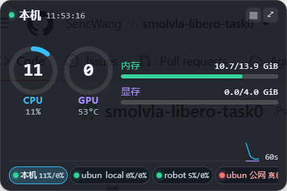
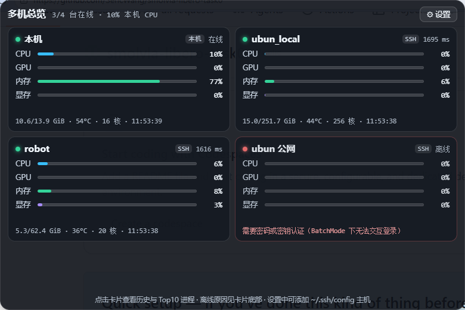
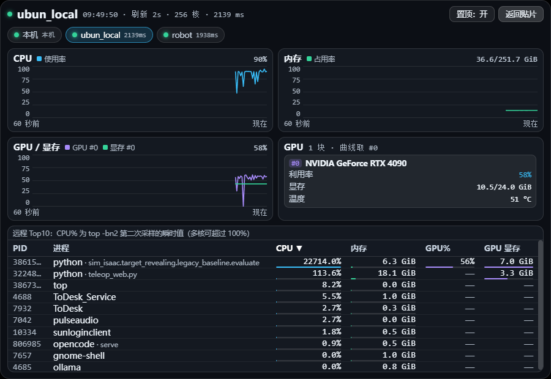

# sysmon-widget

[](https://github.com/SencWang/sysmon-widget/actions/workflows/build.yml)

**English** · [简体中文](README.zh-CN.md)

A frameless, always-on-top desktop widget for Windows that shows **CPU / memory / NVIDIA GPU** usage and **Top-10 processes** of your local machine *and* of any Linux host reachable over SSH — on one small semi-transparent glass panel.



| Multi-host overview | Per-host detail |
| --- | --- |
|  |  |

## Features

- **Three views, one window**
  - `tile` (420×280): rings for CPU/GPU, bars for RAM/VRAM, 60-second sparkline, plus a host strip showing every machine's `CPU%/GPU%` at a glance.
  - `detail` (900×620): history charts for CPU, memory, GPU and VRAM, one card per GPU (utilization / VRAM / temperature), sortable Top-10 process table with per-process **GPU% / GPU memory** columns.
  - `grid` (780×520): one card per host with online dot, SSH latency, four usage bars, and last-update time.
- **Local collection** via [`sysinfo`](https://crates.io/crates/sysinfo) and `nvidia-smi` (spawned without a console window), including per-process GPU via `nvidia-smi pmon` and `--query-compute-apps`.
- **Remote collection over SSH** with a *single* round trip per host: a small POSIX shell script is piped into `ssh <alias> sh -s` and emits self-describing `#CORES / #STAT / #MEM / #GPU / #GPUPROC / #GPUMEM / #PROC / #PROCCMD / #END` records. 8-second timeout, exponential backoff, per-host threads, no UI blocking.
- **Host list auto-syncs from `~/.ssh/config`**: missing `Host` aliases are appended on startup / config reload / manual sync. Existing entries keep their custom label and enabled state; nothing is ever deleted.
- **Instantaneous process CPU** for remote hosts (second sample of `top -bn2`), so a busy python process shows its real current usage rather than a lifetime average.
- **Desktop ergonomics**: frameless and draggable, always-on-top, dark glass styling, tray menu (show/hide, always-on-top, reload config, open config, quit), single instance, optional launch at login, adjustable opacity.
- **No telemetry.** All data stays on your machines.

## How it works

```
┌─────────────── Tauri 2 (Rust) ───────────────┐        ┌──────── Linux host ────────┐
│ sysinfo ── CPU / RAM / processes             │        │ /proc/stat  (2 samples)    │
│ nvidia-smi ── GPU utilization / VRAM / temp  │        │ /proc/meminfo              │
│                                              │  ssh   │ nvidia-smi                 │
│ remote worker (1 thread per host) ───────────┼───────▶│ top -bn2 -d 1 -w 512       │
│   parse #CORES/#STAT/#MEM/#GPU/#PROC/#END    │        └────────────────────────────┘
│   ring buffer history (180 samples/host)     │
└──────────────────┬───────────────────────────┘
                   │ Tauri events: sysmon://snapshot, sysmon://remote
┌──────────────────▼───────────────────────────┐
│ React 19 + TypeScript + hand-written SVG     │
│ tile / detail / grid, tray, settings panel   │
└──────────────────────────────────────────────┘
```

- Local sampling and remote sampling run on independent threads; a dead host never stalls the widget.
- GPU is optional everywhere: if `nvidia-smi` is missing, GPU cards show a placeholder instead of an error.
- Per-process GPU records (`#GPUPROC` / `#GPUMEM`) travel in the same SSH round trip; the remote script sends only `pid SM% mem%` and `pid used_MiB`, so drivers with different `pmon` column layouts still work.
- History lives in memory (default 180 points ≈ 6 min at a 2 s interval) and resets on restart.

## Per-process GPU

The `detail` process table has two extra columns, **GPU%** and **GPU memory**:

- **Data source** — both the local machine and every SSH host run `nvidia-smi pmon -c 1` (SM utilization of the process) and `nvidia-smi --query-compute-apps=pid,used_memory` (exact used VRAM, MiB). Records are merged by PID. VRAM from `compute-apps` wins; when it is unavailable, `pmon`'s `mem` percentage × the card's total VRAM is used as an estimate.
- **Candidate rows** — the table is the union of the Top-N processes by CPU and the Top-N processes by GPU memory (deduplicated). A process that uses a lot of VRAM but little CPU therefore still appears, and the final list is capped at `max(topN, 10)` rows.
- **Sorting** — click `CPU`, `内存` (memory), `GPU%` or `GPU 显存` (GPU memory) to sort ascending/descending. Missing values are rendered as `—` with an explanatory tooltip.
- **Limitations** — NVIDIA only. Windows WDDM does not support per-process GPU accounting: `nvidia-smi pmon` fails and `compute-apps` is empty, so the GPU columns show `—` and the table displays a note under it. The same note appears when a remote host has no usable `nvidia-smi`. MIG / vGPU / container setups may report PIDs that do not match a visible process; those rows keep the PID as their name. `pmon` column layouts vary between drivers, so columns are located by header name rather than fixed positions.


## Telling same-named processes apart

The process table appends a small grey `· <script>` tag to the process name; hovering the row's name cell shows the full command line.

- **Local hosts** — the command line comes from `sysinfo`'s `Process::cmd()` (all arguments joined with spaces).
- **SSH hosts** — `/proc/<pid>/cmdline` is read inside the *existing* single round trip, for the union of the Top-20-by-CPU PIDs and the PIDs reported by `nvidia-smi pmon` / `--query-compute-apps`. No extra SSH connection is opened, and PIDs that were only added because of their GPU memory still get their tag.
- **Tag rule** — `argv[0]` (the interpreter or executable) and options starting with `-` are skipped, then the first remaining argument's file name is shown: `python -u /data/wsc/train_isaac.py --cfg x` → `python · train_isaac.py`. For `python -c ...` the first 24 characters of the code are shown. If no usable argument remains (for example a kernel thread with no cmdline), only the process name is shown.
- **Limits** — command lines are capped at 300 characters. A missing or unreadable `/proc/<pid>/cmdline` just omits the tag; it never fails the sample or the row.


## Requirements

- Windows 10/11 x64, WebView2 runtime (bundled with Windows 11 and current Windows 10).
- NVIDIA GPU + `nvidia-smi` for GPU metrics (optional). Per-process GPU requires a driver that supports `nvidia-smi pmon` / `--query-compute-apps`; Windows WDDM does not.
- OpenSSH client for remote hosts, with **key-based** authentication (`BatchMode=yes`). Password prompts are intentionally unsupported.
- Remote hosts must be POSIX/Linux and provide `/proc`, `top -w`, and optionally `nvidia-smi`.

## Install / build

Download the NSIS installer or MSI from [Releases](https://github.com/SencWang/sysmon-widget/releases) and run it. The app starts in the tray; close the window to hide it, use the tray icon to bring it back.

Every push to `main` builds installers as workflow artifacts (**Actions → build → `sysmon-widget-windows`**); pushing a tag like `v0.2.3` builds the same assets and opens a draft GitHub Release.

From source (Node 20+, Rust stable with the MSVC toolchain):

```powershell
git clone https://github.com/SencWang/sysmon-widget.git
cd sysmon-widget
npm install
npm run tauri dev      # development
npm run tauri build    # release exe + MSI + NSIS installer in src-tauri/target/release
```

Run the test suites:

```powershell
npm run build
cd src-tauri; cargo test
```

## Adding remote hosts

1. Put a normal entry in `~/.ssh/config`:

   ```
   Host lab-gpu
       HostName 192.168.1.20
       User ubuntu
       IdentityFile ~/.ssh/id_ed25519
   ```

2. Make sure `ssh lab-gpu` works without a password (key or ssh-agent).
3. Restart the widget, or click **Reload config** in the tray, or use **Sync SSH aliases** in the settings panel. New aliases are appended automatically.

Only *missing* aliases are added; disabling or renaming a host in the settings panel is preserved across syncs. `Host` patterns containing `*`, `?` or `!` are ignored.

## Configuration

`%APPDATA%\com.scwang.sysmonwidget\config.json` (created on first run):

| Key | Default | Meaning |
| --- | --- | --- |
| `refreshMs` | `2000` | local refresh interval; remote hosts use `max(refreshMs, 3000)` |
| `historyPoints` | `180` | history samples kept per host |
| `topN` | `10` | candidate processes per host: Top-N by CPU plus Top-N by GPU memory (table shows at most `max(topN, 10)` rows) |
| `opacity` | `0.92` | panel opacity multiplier (0.6–1.0) |
| `alwaysOnTop` | `true` | keep the widget above other windows |
| `autostart` | `false` | launch at login (HKCU `Run` key, no admin rights) |
| `view` | `"tile"` | last active view: `tile`, `detail`, `grid` |
| `tileHostId` | `"local"` | host shown in the tile (`local` or `ssh:<alias>`) |
| `localLabel` | `"本机"` | display name for the local machine |
| `servers` | `[]` | remote hosts: `{ id, label, alias, enabled }`, auto-filled from ssh config |

Tray menu: **Show/Hide**, **Always on top**, **Reload config**, **Open config file**, **Quit**. Tray tooltip shows `local CPU · memory · online hosts`.

## Known limitations

- Remote hosts must be Linux/POSIX; Windows remotes are not supported yet.
- GPU support is NVIDIA-only (`nvidia-smi`); AMD/Intel GPUs show no data.
- Per-process GPU data is unavailable on Windows WDDM (GPU columns show `—` and a note); it also needs a driver and a non-MIG setup where `pmon` / `--query-compute-apps` report usable PIDs.
- Password / keyboard-interactive SSH authentication is not implemented by design.
- History is in-memory only; there is no long-term storage or alerting.
- Built and tested on Windows 11 with WebView2 157; other Windows versions should work but are untested.

## License

[MIT](LICENSE) © 2026 SencWang