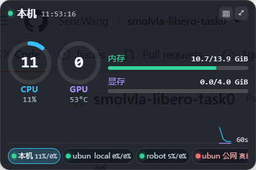
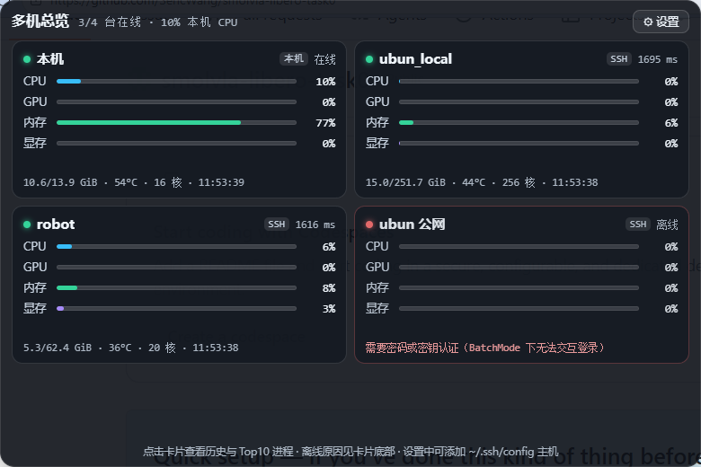
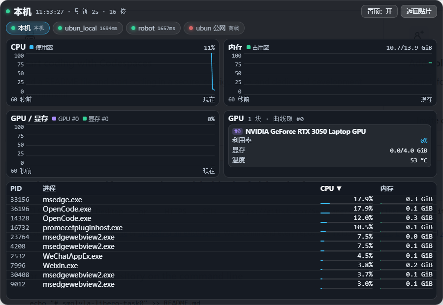

# sysmon-widget

[](https://github.com/SencWang/sysmon-widget/actions/workflows/build.yml)

[English](README.md) · **简体中文**

一个常驻 Windows 桌面的无边框半透明贴片，在一屏内显示**本机**以及**所有可通过 SSH 连接的 Linux 主机**的 CPU / 内存 / NVIDIA GPU 占用和 Top10 进程。



| 多机总览 | 单机详情 |
| --- | --- |
|  |  |

## 功能

- **一个窗口，三种视图**
  - `tile`（420×280）：CPU / GPU 环形进度、内存 / 显存横条、60 秒迷你曲线；底部主机选择条直接显示每台机器的 `CPU%/GPU%`。
  - `detail`（900×620）：CPU、内存、GPU / 显存历史曲线，每块 GPU 一张小卡（利用率 / 显存 / 温度），可排序的 Top10 进程表。
  - `grid`（780×520）：每台主机一张卡片，含在线状态点、SSH 延迟、四条占用条与最近更新时间。
- **本机采集**：`sysinfo` 取 CPU / 内存 / 进程，`nvidia-smi` 取 GPU（CREATE_NO_WINDOW，不闪黑框）。
- **SSH 远程采集**：每台主机**一次 SSH 往返**。把一段 POSIX shell 脚本写入 `ssh <alias> sh -s` 的标准输入，远端输出 `#CORES / #STAT / #MEM / #GPU / #PROC / #END` 自描述记录；8 秒整体超时、失败指数退避、每台主机独立线程，互不阻塞，也不卡界面。
- **主机列表自动同步 `~/.ssh/config`**：启动时、重载配置时、或手动点「同步 SSH 别名」时，把缺失的 `Host` 别名自动追加；已有主机保留自定义显示名与启用状态，**只增不删**。
- **远程进程 CPU 是瞬时值**（`top -bn2` 第二段），不是进程启动以来的平均值；多核机器上可以超过 100%。
- **桌面体验**：无边框可拖动、置顶、深色毛玻璃、托盘菜单（显示/隐藏、置顶、重新加载配置、打开配置、退出）、单实例、可选开机自启、不透明度可调。
- **无遥测**，数据只在本机与你的服务器之间流动。

## 工作原理

```
┌─────────────── Tauri 2 (Rust) ───────────────┐        ┌──────── Linux 主机 ────────┐
│ sysinfo ── CPU / 内存 / 进程                  │        │ /proc/stat（两次采样）      │
│ nvidia-smi ── GPU 利用率 / 显存 / 温度        │        │ /proc/meminfo              │
│                                              │  ssh   │ nvidia-smi                 │
│ 远程采集线程（每主机一个）────────────────────┼───────▶│ top -bn2 -d 1 -w 512       │
│   解析 #CORES/#STAT/#MEM/#GPU/#PROC/#END     │        └────────────────────────────┘
│   每主机历史环形缓冲（180 点）                │
└──────────────────┬───────────────────────────┘
                   │ Tauri 事件：sysmon://snapshot、sysmon://remote
┌──────────────────▼───────────────────────────┐
│ React 19 + TypeScript + 手写 SVG 图表        │
│ tile / detail / grid、托盘、设置面板          │
└──────────────────────────────────────────────┘
```

- 本机采样与远程采样是彼此独立的线程，某台机器掉线不会影响其他主机或界面刷新。
- GPU 是可选项：没有 `nvidia-smi` 时显示占位，而不是报错弹窗。
- 历史数据只存在内存里（默认 180 点，2 秒间隔约 6 分钟），重启后重新累积。

## 环境要求

- Windows 10/11 x64，WebView2 运行时（Windows 11 与较新的 Windows 10 自带）。
- 需要 GPU 指标时：NVIDIA 显卡 + `nvidia-smi`（可选）。
- 远程主机需要 OpenSSH 客户端，并使用**密钥认证**（程序固定 `BatchMode=yes`，不会弹密码框）。
- 远程主机需为 POSIX/Linux，提供 `/proc`、`top -w`，可选 `nvidia-smi`。

## 安装 / 构建

从 [Releases](https://github.com/SencWang/sysmon-widget/releases) 下载 NSIS 安装包或 MSI 直接安装。程序启动后驻留托盘：关闭窗口只是隐藏，点击托盘图标可重新显示。

每次推送到 `main` 都会自动构建安装包并作为 workflow 产物提供（**Actions → build → `sysmon-widget-windows`**）；推送 `v0.2.1` 这类 tag 会构建同样的产物并生成一个草稿 Release。

从源码构建（Node 20+、Rust stable + MSVC 工具链）：

```powershell
git clone https://github.com/SencWang/sysmon-widget.git
cd sysmon-widget
npm install
npm run tauri dev      # 开发模式
npm run tauri build    # 产物：src-tauri/target/release 下的 exe + MSI + NSIS 安装包
```

运行测试：

```powershell
npm run build
cd src-tauri; cargo test
```

## 添加远程主机

1. 在 `~/.ssh/config` 中写一条普通配置：

   ```
   Host lab-gpu
       HostName 192.168.1.20
       User ubuntu
       IdentityFile ~/.ssh/id_ed25519
   ```

2. 确认 `ssh lab-gpu` 可以免密登录（密钥或 ssh-agent）。
3. 重启贴片，或在托盘点「重新加载配置」，或在设置面板点「同步 SSH 别名」。缺失的别名会自动加入。

只追加缺失项：你在设置面板里改过的显示名、禁用状态不会在同步时被覆盖；带 `*` `?` `!` 的 `Host` 通配项会被忽略。

## 配置说明

`%APPDATA%\com.scwang.sysmonwidget\config.json`（首次运行自动生成）：

| 字段 | 默认值 | 说明 |
| --- | --- | --- |
| `refreshMs` | `2000` | 本机刷新间隔；远程主机实际使用 `max(refreshMs, 3000)` |
| `historyPoints` | `180` | 每台主机保留的历史点数 |
| `topN` | `10` | 每台主机显示的进程数 |
| `opacity` | `0.92` | 面板不透明度系数（0.6–1.0） |
| `alwaysOnTop` | `true` | 是否置顶 |
| `autostart` | `false` | 开机自启（写 HKCU `Run`，无需管理员权限） |
| `view` | `"tile"` | 上次视图：`tile` / `detail` / `grid` |
| `tileHostId` | `"local"` | 贴片当前显示的主机（`local` 或 `ssh:<alias>`） |
| `localLabel` | `"本机"` | 本机显示名 |
| `servers` | `[]` | 远程主机：`{ id, label, alias, enabled }`，由 ssh config 自动补齐 |

托盘菜单：**显示/隐藏**、**置顶**、**重新加载配置**、**打开配置文件**、**退出**。托盘 tooltip 显示 `本机 CPU · 内存 · 在线主机数`。

## 已知限制

- 远程主机仅支持 Linux/POSIX，暂不支持 Windows 远程。
- GPU 仅支持 NVIDIA（依赖 `nvidia-smi`），AMD/Intel 显卡不显示数据。
- 不支持密码 / 键盘交互式 SSH 认证（有意为之）。
- 历史数据只在内存中，没有持久化存储与告警功能。
- 开发与验证环境为 Windows 11 + WebView2 157，其他 Windows 版本未实测。

## 许可证

[MIT](LICENSE) © 2026 SencWang